<p align="center">
  
</p>

<p align="center">
  <a href="https://www.anypayx.com"></a>
  <a href="https://wordpress.org/plugins/anypay-woocommerce/"></a>
  <a href="https://wordpress.org/plugins/anypay-woocommerce/"></a>
  <a href="LICENSE"></a>
</p>

<p align="center">
  <a href="https://www.anypayx.com">Website</a> ·
  <a href="https://www.anypayx.com/docs">Docs</a> ·
  <a href="https://api.anypayx.com/api">API</a> ·
  <a href="https://www.anypayx.com/woocommerce">WooCommerce</a> ·
  <a href="https://github.com/anypay">GitHub</a>
</p>

---

## What It Is & Purpose

**Anypay for WooCommerce** is the official payment gateway plugin that enables WordPress merchants to accept Bitcoin, Ethereum, and stablecoins (USDC, USDT, RLUSD, NUSD) directly on their WooCommerce store. Customers pay with their crypto wallet, funds settle instantly to the merchant's wallet, and orders are automatically marked complete via secure webhooks.

This plugin eliminates volatility risk through instant stablecoin settlements and removes intermediaries — your customers' payments flow peer-to-peer from their wallet to yours. No custody, no delays, no chargebacks. Just simple, direct Bitcoin and multi-coin checkout for e-commerce.

## Why Use It

**Anypay for WooCommerce** turns your WordPress store into a Bitcoin & stablecoin payment terminal. Unlike traditional payment processors that hold funds and charge percentage fees, Anypay routes payments directly from your customer's wallet to your wallet with a fixed 0.1% platform fee taken automatically as a multi-output split.

- **Who it's for:** WooCommerce merchants who want to accept cryptocurrency payments — online stores, digital goods vendors, global e-commerce businesses, and merchants seeking to avoid credit card fees and chargebacks.
- **Where it fits:** This plugin integrates directly into the WooCommerce checkout flow, using the [Anypay Invoice API](https://api.anypayx.com/api) to generate payment requests and the [Anypay Checkout](https://checkout.anypayx.com) UI to present payment options. It sits between WooCommerce's payment gateway system and Anypay's platform, with webhooks bridging the on-chain payment confirmation back to order fulfillment.

**Key benefits:**

- ✅ **Multi-coin support** — Accept Bitcoin (BTC), Bitcoin Cash (BCH), Bitcoin SV (BSV), Ethereum (ETH), Litecoin (LTC), Dogecoin (DOGE), Dash (DASH), Stellar (XLM), Solana (SOL), Polygon (MATIC), Avalanche (AVAX), Binance Chain, plus stablecoins USDC, USDT, RLUSD, and NUSD
- ✅ **Direct wallet-to-wallet** — No custody, no KYC friction, no account holds
- ✅ **Instant settlement** — Stablecoin payments arrive immediately with zero volatility risk
- ✅ **Automatic order completion** — Webhooks update WooCommerce orders from pending to paid in real-time
- ✅ **No chargebacks** — Crypto payments are final and irreversible
- ✅ **Fixed low fee** — 0.1% platform fee taken automatically, no percentage of sales
- ✅ **Easy setup** — Just paste your Anypay API key; no complex integration

## How It Works

<p align="center">
  
</p>

The payment flow has four stages:

1. **WooCommerce Checkout** — Customer completes their cart and selects "Anypay" as the payment method. The plugin captures the order total and customer redirect URL.

2. **Anypay Invoice** — The plugin sends a `POST` request to `https://api.anypayx.com/invoices` with the order amount, your merchant API key, a webhook callback URL (`/?wc-api=wc_gateway_anypay`), and the WooCommerce order ID as `external_id`. The API returns a unique invoice UID.

3. **Crypto Payment** — The customer is redirected to `https://anypayx.com/i/{uid}`, where the Anypay Checkout UI presents payment options across all supported chains. The customer scans a QR code or clicks a wallet link, signs the transaction, and broadcasts it on-chain.

4. **Order Complete** — When the transaction is confirmed, Anypay's webhook system sends a signed `POST` to your site's callback URL with the invoice status (`paid`), transaction hash, amount paid, and order ID. The plugin verifies the payload, calls `$order->payment_complete($invoice_uid)`, and WooCommerce marks the order as complete.

**Data stored:** The plugin creates a local `wp_woocommerce_anypay_invoices` table to track invoice UID, status, payment hash, amount paid, and denomination for reconciliation and admin reporting.

## Quickstart / How to Use It

### Prerequisites

- WordPress 4.0 or higher
- PHP 5.6 or higher
- WooCommerce plugin installed and active
- An [Anypay account](https://www.anypayx.com/auth/signup) with an API key

### Installation

1. **Download the plugin:**
   - From WordPress.org: [https://wordpress.org/plugins/anypay-woocommerce/](https://wordpress.org/plugins/anypay-woocommerce/)
   - Or manually: Clone this repository into `wp-content/plugins/anypay-woocommerce/`

2. **Activate the plugin:**
   - In your WordPress admin, navigate to **Plugins → Installed Plugins**
   - Find "Anypay WooCommerce" and click **Activate**

3. **Configure the payment gateway:**
   - Go to **WooCommerce → Settings → Payments**
   - Enable **Anypay** and click **Manage**
   - Paste your **Anypay API key** (get yours at [anypayx.com/auth/login](https://www.anypayx.com/auth/login))
   - Save changes

4. **Test the checkout:**
   - Add a product to your cart and proceed to checkout
   - Select "Anypay" as payment method
   - You'll be redirected to `anypayx.com/i/{invoice_uid}` to complete payment
   - After payment, the webhook updates your order to "Processing" or "Completed"

### API Key Setup

Your API key authenticates requests to the Anypay Invoice API. To obtain one:

1. Sign up or log in at [https://www.anypayx.com/auth/signup](https://www.anypayx.com/auth/signup)
2. Navigate to **Account → API Keys**
3. Generate a new API key
4. Copy and paste it into the WooCommerce Anypay settings

**Security note:** API keys are sent as HTTP Basic Auth headers (`Authorization: Basic {base64(api_key:)}`). Store them securely and never commit them to public repositories.

### Webhook Configuration

The plugin automatically registers a webhook endpoint at:

```
https://your-site.com/?wc-api=wc_gateway_anypay
```

Anypay sends `POST` requests to this URL when invoices are paid. The webhook payload includes:

```json
{
  "status": "paid",
  "uid": "invoice-uid-string",
  "hash": "transaction-hash",
  "output_hash": "payment-output-hash",
  "invoice_amount_paid": 49.99,
  "external_id": 12345
}
```

The plugin sanitizes all fields, updates the local invoice table, and calls `$order->payment_complete()` to finalize the WooCommerce order.

**Supported chains:** BTC, BCH, BSV, ETH, LTC, DOGE, DASH, XLM, SOL, MATIC, AVAX, BNB, plus stablecoins USDC, USDT, RLUSD, NUSD on supported networks.

## Next Moves for Growth

This plugin is production-ready, but there are high-leverage improvements that could expand adoption and robustness:

1. **WordPress Plugin Directory optimization** — The current stable tag in `trunk/readme.txt` is `0.6.1`, but the plugin header in `trunk/anypay_woocommerce.php` declares version `0.7.0`. Sync these versions and publish a tagged `0.7.0` release to the WordPress.org SVN repository so users receive update notifications.

2. **Enhanced webhook security** — Currently, webhooks validate field length and type but do not verify cryptographic signatures. Add HMAC-SHA256 signature verification using a shared webhook secret to prevent spoofed payment confirmations from malicious actors.

3. **Admin dashboard reporting** — The `wp_woocommerce_anypay_invoices` table stores payment data but has no UI. Build a **WooCommerce → Anypay Payments** admin page to display invoice history, reconciliation reports, refund lookups (invoices can be queried via the [Anypay API](https://api.anypayx.com/api)), and payment analytics.

4. **Multi-currency pricing display** — Add a shortcode or WooCommerce filter hook to show real-time crypto/stablecoin prices alongside fiat prices on product pages, pulling from the [Anypay Prices API](https://www.anypayx.com/prices) so customers see "Pay $50 USD or 0.00084 BTC".

5. **Automated testing & CI** — The `.circleci/` folder exists but no test suite is present. Add PHPUnit tests for invoice creation, webhook processing, and WooCommerce order state transitions, then wire them into CircleCI to catch regressions before WordPress.org releases.

6. **Localization / i18n** — The plugin uses hardcoded English strings. Wrap all user-facing text in `__()` and `_e()` calls, generate a `.pot` translation template, and register the plugin on [translate.wordpress.org](https://translate.wordpress.org) so international merchants can contribute translations.

7. **Partial payment & refund handling** — The current flow assumes full payment. Extend the webhook handler to support underpayment edge cases (amount paid < amount due) and add a **Refunds** tab in the admin panel to query the Anypay API for refund transactions.

## Anypay Ecosystem & License

**Anypay for WooCommerce** is part of [Anypay](https://www.anypayx.com) — Bitcoin & Stablecoin payments for business. Merchants and developers use Anypay to accept BTC, ETH, and stablecoins such as USDC, USDT, RLUSD, and NUSD through invoices, APIs, SDKs, webhooks, WooCommerce, and mobile POS.

| Project | Role |
| --- | --- |
| [anypay](https://github.com/anypay/anypay) | Invoice & payments platform / API (`@anypay/server`) |
| [anypay-sdk](https://github.com/anypay/anypay-sdk) | TypeScript SDK for browser & Node.js (`@anypay/client`) |
| [web3-checkout-vite](https://github.com/anypay/web3-checkout-vite) | Current checkout UI (`checkout.anypayx.com`) |
| [walletbot](https://github.com/anypay/walletbot) | Self-custody headless wallet (`@anypay/walletbot`) |
| [anypayx.com](https://github.com/anypay/anypayx.com) | Marketing site, merchant dashboard, and developer docs |
| [merchant-app](https://github.com/anypay/merchant-app) | iOS & Android point-of-sale |

**Related WooCommerce resources:**

- Official WooCommerce plugin page: [https://www.anypayx.com/woocommerce](https://www.anypayx.com/woocommerce)
- WordPress.org listing: [https://wordpress.org/plugins/anypay-woocommerce/](https://wordpress.org/plugins/anypay-woocommerce/)
- API reference: [https://api.anypayx.com/api](https://api.anypayx.com/api)

**License:** This plugin is licensed under the GNU General Public License v2.0 or later ([GPLv2+](https://www.gnu.org/licenses/gpl-2.0.html)). You are free to use, modify, and distribute this software under the terms of the GPL.

**Contributors:** [@owenkellogg](https://github.com/owenkellogg), [@brandonbryant](https://github.com/brandonbryant), [@eddiewillers](https://github.com/eddiewillers), [@pshenmic](https://github.com/pshenmic)

---

<p align="center">
  <a href="https://www.anypayx.com"></a><br/>
  <sub>Bitcoin & Stablecoin Payments For Business · <a href="https://www.anypayx.com">anypayx.com</a> · <a href="https://x.com/xanypay">@xanypay</a></sub>
</p>
